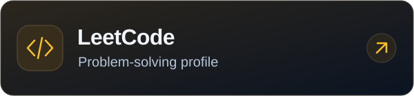
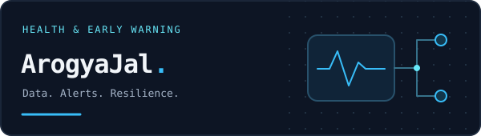
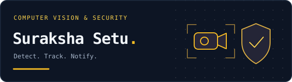
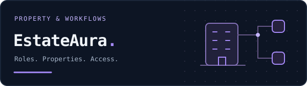
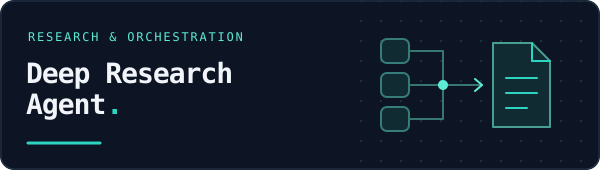

  

<table>
  <tr>
    <td width="50%"></td>
    <td width="50%"></td>
  </tr>
  <tr>
    <td width="50%"></td>
    <td width="50%"></td>
  </tr>
</table>

<a href="https://priyanshu-sharma.tech/assets/resume.pdf">Read the résumé ↗</a>

  <a href="#selected-work">Selected work</a> ·
  <a href="#recognition--credentials">Recognition</a> ·
  <a href="#community">Community</a> ·
  <a href="#lets-connect">Connect</a>

## Hey, I'm Priyanshu 👋

I'm a **Java backend developer** and **BTech CSE (Cybersecurity) student at AITR, Indore**, building APIs, dependable data workflows, and systems that connect software to real-world problems.

**REST APIs · Real-time alerts · Offline sync · Computer vision**

## Selected work

### Singtel Scout - Team Catalyst

**Merit Award, Emerging Technologies track - Singapore-India Hackathon 2026.**

An AI-assisted enterprise lead-qualification tool that brings together company filings, news, tenders and CRM signals, ranks opportunities and explains the evidence behind them.

- **My contribution:** customer portfolio and CRM dashboard workflows, customer-graph integration, sales analytics and evidence presentation.
- **Team stack:** TypeScript, Node.js, Express, React, MongoDB and Neo4j.
- [Live demo](https://singtel-scout.vercel.app/) · [Team repository](https://github.com/SNishanth2202/Singapore-hackathon) · [Organizer's award announcement](https://www.linkedin.com/feed/update/urn:li:activity:7530200901395865600/)

<table>
  <tr>
    <td valign="top" width="50%">
      
      <h3>01 / ArogyaJal</h3>
      
<strong>Health monitoring · SIH 2025 winner</strong> Backend developer · Team CORE_401 · Aug 2025 - Mar 2026

      
Government-deployed water quality monitoring and disease surveillance, developed with Team CORE_401.

      <ul>
        <li><strong>190+ REST APIs across 25 modules.</strong></li>
        <li><strong>WebSocket alerts</strong> and integrated IoT data flows.</li>
        <li><strong>Offline-first synchronization</strong> for low-connectivity environments.</li>
      </ul>
      
<code>Java</code> <code>Spring Boot</code> <code>Firebase Firestore</code>

      
<a href="https://github.com/Priyanshu-10112/ArogyaJal"><strong>Repository ↗</strong></a> · <a href="https://arogyajal.netlify.app/"><strong>Public website ↗</strong></a>

    </td>
    <td valign="top" width="50%">
      
      <h3>02 / Suraksha-Setu</h3>
      
<strong>Computer vision · Multi-camera monitoring</strong>

      
AI-powered person detection across normal, safe, and restricted zones.

      <ul>
        <li><strong>YOLOv8 + IoU tracking</strong> with color-coded live MJPEG feeds.</li>
        <li><strong>WebSocket alerts</strong> and SQLite history with captured frames.</li>
        <li><strong>Camera reconnection</strong> and REST APIs with Swagger documentation.</li>
      </ul>
      
<code>Python 3.10</code> <code>FastAPI</code> <code>OpenCV</code> <code>SQLite</code>

      
<a href="https://github.com/Priyanshu-10112/Suraksha-setu"><strong>Repository ↗</strong></a>

    </td>
  </tr>
  <tr>
    <td valign="top" width="50%">
      
      <h3>03 / EstateAura</h3>
      
<strong>Real estate management · Solo project</strong>

      
A role-based system connecting property workflows, users, and appointments.

      <ul>
        <li>Authentication and role-based property workflows.</li>
        <li>Appointment scheduling with OTP verification.</li>
      </ul>
      
<code>Java</code> <code>Spring Boot</code> <code>MySQL</code>

      
<a href="https://github.com/Priyanshu-10112/Real-Estate"><strong>Repository ↗</strong></a>

    </td>
    <td valign="top" width="50%">
      
      <h3>04 / Deep Research Agent</h3>
      
<strong>Research orchestration · Completed project</strong> Backend developer

      
Spring Boot services that coordinate external APIs and store structured research outputs in MySQL.

      <ul>
        <li>Parallel API calls with aggregated results.</li>
        <li>Relevance filtering and AI-assisted summarization.</li>
      </ul>
      
<code>Java</code> <code>Spring Boot</code> <code>MySQL</code>

      
<a href="https://github.com/Priyanshu-10112/DeepResearchAgent"><strong>Repository ↗</strong></a>

    </td>
  </tr>
</table>

## Recognition & credentials

<table>
  <tr>
    <td valign="top" width="50%">
      <h3>Awards</h3>
      <ul>
        <li><strong>Singapore–India Hackathon 2026</strong> Merit Award · Emerging Technologies track · Team Catalyst · Singtel Scout</li>
        <li><strong>Smart India Hackathon 2025</strong> Winner · Team CORE_401 · ArogyaJal</li>
        <li><strong>Global Innovation Excellence Award 2026</strong> Winner · ArogyaJal · W-AHEAD, New Delhi</li>
        <li><strong>Mediverse Hackathon 2025</strong> 3rd place</li>
        <li><strong>IEEE IGNITE 2.0, 2026</strong> 2nd Prize · Research presentation</li>
        <li><strong>RAMSITA 2026 International Conference</strong> Best Poster Award · 1st place</li>
      </ul>
      
<a href="https://priyanshu-sharma.tech/#achievements">Award details ↗</a>

    </td>
    <td valign="top" width="50%">
      <h3>Credentials</h3>
      <ul>
        <li><a href="https://www.credly.com/badges/4f4786f2-0f38-4405-b437-e54c31470afc/linked_in?t=th1c5m"><strong>AWS Certified Cloud Practitioner ↗</strong></a> Issued June 2026 · Valid through June 2029</li>
        <li><a href="https://priyanshu-sharma.tech/assets/certificates/nptel-java-2026.pdf"><strong>NPTEL Programming in Java ↗</strong></a> 91% · Elite · 2026</li>
        <li><a href="https://priyanshu-sharma.tech/assets/certificates/nptel-oop.pdf"><strong>NPTEL Fundamentals of OOP ↗</strong></a> 91% · Top 2% · Elite · 2025</li>
        <li><a href="https://priyanshu-sharma.tech/assets/certificates/google-cloud.pdf"><strong>Google Cloud Career Launchpad - Computing Foundations</strong></a> 2025</li>
        <li><a href="https://priyanshu-sharma.tech/assets/certificates/nptel-dbms.pdf"><strong>NPTEL Data Base Management System</strong></a> 70% · 2025</li>
        <li><a href="https://priyanshu-sharma.tech/assets/certificates/cps-iot.pdf"><strong>CPS &amp; IoT Training Workshop</strong></a> IIT Ropar CPS Lab / AITR · 2025</li>
      </ul>
    </td>
  </tr>
</table>

## Toolbox

  

**Backend & data:** REST APIs · JDBC · WebSockets · Swagger · Firebase Firestore  
**Enterprise data:** TypeScript · Node.js / Express · MongoDB · Neo4j 
**Frontend & workflow:** React · JSP · GitHub · n8n

## Community

- **VTools Manager - IEEE TEMS Student Branch Chapter, AITR:** student community role, Jan 2026 - Present.

- **Technical speaker & mentor:** conducted technical sessions for 250+ students on Java, Spring Boot, Python, and backend development.

## Let's connect

**B.Tech student seeking backend/software internships and fresher roles.**

Explore more work at **[priyanshu-sharma.tech ↗](https://priyanshu-sharma.tech)**, connect on **[LinkedIn ↗](https://www.linkedin.com/in/priyanshu-sharma10/)**, or find me on **[LeetCode ↗](https://leetcode.com/u/priyanshusharma08/)**.

Find me on <a href="https://www.chess.com/member/priyanshu10113">Chess.com ↗</a>, too.

