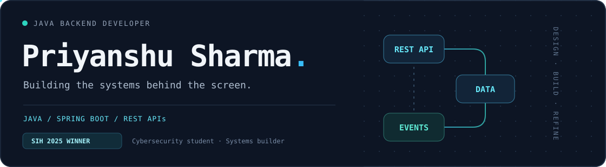

  

  <a href="#selected-work">Selected work</a> ·
  <a href="#toolbox">Toolbox</a> ·
  <a href="#github-activity">Activity</a> ·
  <a href="#lets-connect">Connect</a>

## Hey, I'm Priyanshu 👋

I'm a **Java backend developer** and **BTech Cybersecurity student** who likes turning complex workflows into clear APIs and dependable data flows.

My work spans health monitoring, real-time alerts, offline synchronization, and property management. I care about what happens behind the interface: **API design, data consistency, access control, and systems that keep working when conditions aren't ideal.**

## Selected work

### 01 / AarogyaJal

**Smart health monitoring · SIH 2025 winner · Backend developer**

A system for early detection of water-borne diseases, connecting health data, IoT inputs, alerts, and reporting.

<table>
  <tr>
    <td align="center" width="33%"><strong>190+</strong> REST APIs</td>
    <td align="center" width="33%"><strong>25</strong> Backend modules</td>
    <td align="center" width="33%"><strong>Offline-first</strong> Data synchronization</td>
  </tr>
</table>

- Built with **Spring Boot + Firebase Firestore**.
- Implemented **WebSocket alerts** and offline data synchronization for low-connectivity environments.
- Integrated IoT data into health monitoring workflows.

**[Explore the repository ↗](https://github.com/Priyanshu-10112/ArogyaJal)** · **[Live demo ↗](https://arogyajal.netlify.app/)**

<table>
  <tr>
    <td valign="top" width="50%">
      <h3>02 / EstateAura</h3>
      
<strong>Real estate management · Solo project</strong>

      
Role-based property workflows, authentication, appointment scheduling, and OTP verification.

      
<code>Java</code> <code>Spring Boot</code> <code>MySQL</code>

      
<a href="https://github.com/Priyanshu-10112/Real-Estate"><strong>Explore the repository ↗</strong></a>

    </td>
    <td valign="top" width="50%">
      <h3>03 / Deep Research Agent</h3>
      
<strong>Research orchestration · Backend system</strong>

      
Aggregates multiple data sources into structured outputs through backend orchestration and data processing pipelines.

      
<code>Java</code> <code>Data pipelines</code> <code>Orchestration</code>

      
<a href="https://github.com/Priyanshu-10112/DeepResearchAgent"><strong>Explore the repository ↗</strong></a>

    </td>
  </tr>
</table>

## Toolbox

  

| Layer | What I work with |
| :--- | :--- |
| Backend | Java · Spring Boot · REST APIs · JDBC · WebSockets |
| Data | MySQL · Firebase Firestore · Offline synchronization |
| Frontend & workflow | React · JSP · Git · GitHub · n8n |

## GitHub activity

## Let's connect

Java, backend systems, and useful ideas — always happy to talk.

  
  
  

Clean APIs. Thoughtful data flows. Useful software.

